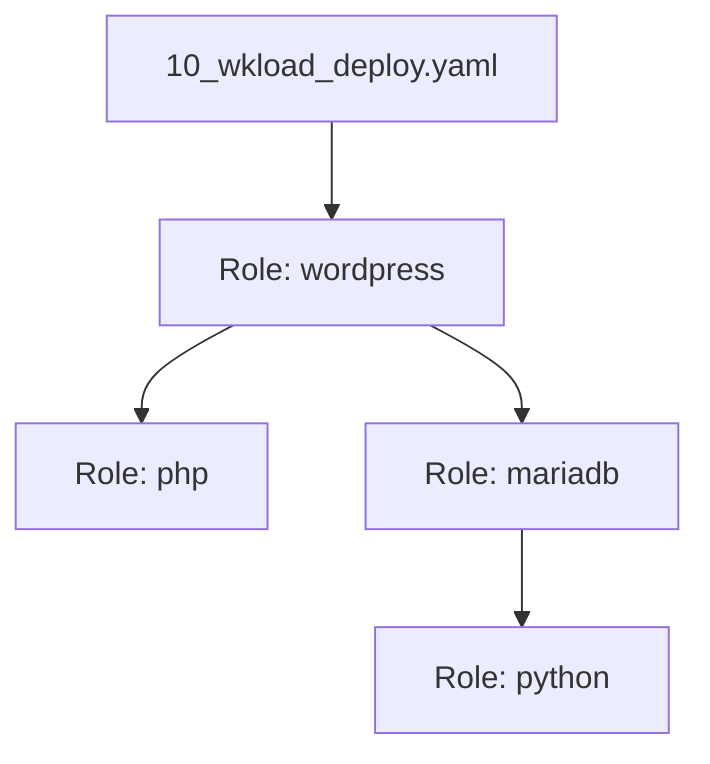

# Ansible Lab — Operations Guide

This repository contains a hands-on Ansible lab covering basic playbooks, Multipass VM provisioning, and deploying WordPress + MariaDB both with standalone playbooks and with reusable Ansible roles.

---

## Project Structure

```text
.
├── ansible.cfg                        # Default Ansible configuration (inventory, interpreter, vault)
├── inventory.ini                      # Default inventory (auto-updated by 00_vms.yaml)
├── inventory.yaml                     # Alternative YAML inventory (auto-updated by 00_vms.yaml)
├── Makefile                           # Common automation targets
├── capitulos/                         # Course chapter notes
└── src/                               # Playbooks, requirements, and roles
    ├── README.md
    ├── 00_facts.yaml                  # Gather & print localhost facts
    ├── 10_hello.yaml                  # Basic Hello World playbook with variables
    ├── 00_reqs/                       # Ansible Galaxy collection requirements
    ├── 10_infra/                      # Multipass VM lifecycle, SSH key setup & dynamic inventory
    ├── 20_deploy_no_roles/            # Monolithic WordPress + MariaDB playbooks
    ├── 30_deploy_with_roles/          # Role-based deployment playbooks
    └── roles/                         # Modular roles (python, php, mariadb, wordpress)
```

Each folder under [`src/`](./src/README.md) has its own `README.md` with detailed usage instructions:
- [`src/README.md`](./src/README.md) — Overview & introductory playbooks (`00_facts.yaml`, `10_hello.yaml`)
- [`src/00_reqs/README.md`](./src/00_reqs/README.md) — Installing Ansible Galaxy collections
- [`src/10_infra/README.md`](./src/10_infra/README.md) — Creating/destroying Multipass VMs and configuring SSH
- [`src/20_deploy_no_roles/README.md`](./src/20_deploy_no_roles/README.md) — Deploying WordPress without roles
- [`src/30_deploy_with_roles/README.md`](./src/30_deploy_with_roles/README.md) — Deploying WordPress with roles
- [`src/roles/README.md`](./src/roles/README.md) — Documentation for modular roles (`python`, `php`, `mariadb`, `wordpress`)

---

## Makefile Quick Reference

| Target | Description |
|---|---|
| `make deps` | Installs OS packages (`python3`, `pip`, `venv`, `pipx`, `jq`), Multipass snap, and Ansible |
| `make ansible_reqs` | Installs required Ansible Galaxy collections from `src/00_reqs/00_requirements.yaml` |
| `make infra_create` | Provisions bridged VM `demo`, configures SSH keys, and generates inventory files |
| `make infra_facts` | Gathers and displays all Ansible facts known for the `demo` VM |
| `make wkload_deploy_no_roles` | Deploys WordPress stack without roles via [`src/20_deploy_no_roles/40_wkload_deploy.yaml`](./src/20_deploy_no_roles/40_wkload_deploy.yaml) |
| `make wkload_deploy_roles` | Deploys WordPress stack using modular roles via [`src/30_deploy_with_roles/10_wkload_deploy.yaml`](./src/30_deploy_with_roles/10_wkload_deploy.yaml) |
| `make infra_destroy` | Destroys and purges VM `demo` and empties `inventory.ini` and `inventory.yaml` |

---

## Prerequisites

- **Python 3** (`>= 3.8.0`)
- **Multipass** ([Install guide](https://multipass.run/install))
- **pipx** ([Install guide](https://pipx.pypa.io/stable/))
- **jq** (used by `00_vms.yaml` to parse Multipass JSON output)

Install all system dependencies and Ansible via `make`:
```bash
make deps
```
*(Or manually run `pipx install --include-deps ansible` if `python3`, `multipass`, `pipx`, and `jq` are already installed.)*

---

## Step-by-Step Operations Workflow

All commands below should be run from the repository root (`/home/toor/DEVOPS_DEV/ansible-lab`).

### Step 1: Install Ansible Galaxy Requirements
Install the required collections (`theko2fi.multipass`, `community.mysql`, `community.crypto`) defined in [`src/00_reqs/00_requirements.yaml`](./src/00_reqs/00_requirements.yaml):

```bash
make ansible_reqs
# or directly:
ansible-galaxy install -r src/00_reqs/00_requirements.yaml
```

### Step 2: Run Introductory Playbooks (Localhost)
Verify your local Ansible setup before provisioning VMs:

```bash
# Gather and print localhost facts
ansible-playbook -c local src/00_facts.yaml

# Print a greeting using an extra variable
ansible-playbook src/10_hello.yaml -e "user=toor"
```

### Step 3: Provision the Lab VM & Configure SSH (`10_infra`)
Run `make infra_create` (which runs [`src/10_infra/00_vms.yaml`](./src/10_infra/00_vms.yaml) with tags `create` and `bridge`, followed by [`src/10_infra/10_copy_ssh_key.yaml`](./src/10_infra/10_copy_ssh_key.yaml)):

```bash
make infra_create
```

#### Example Output:
```text
PLAY [Lab VMs] *****************************************************************
TASK [Gathering Facts] *********************************************************
ok: [localhost]
TASK [Generate ssh keys] *******************************************************
ok: [localhost]
TASK [Check bridge br-ens33 status] ********************************************
ok: [localhost]
TASK [Launch instance on bridge] ***********************************************
changed: [localhost]
RUNNING HANDLER [HANDLER Sync public key to workspace .ssh directory for Multipass transfer] ***
ok: [localhost]
TASK [Transfer public key to instance] *****************************************
changed: [localhost]

PLAY RECAP *********************************************************************
localhost                  : ok=5    changed=2    unreachable=0    failed=0    skipped=0    rescued=0    ignored=0   

PLAY [Lab VMs] *****************************************************************
TASK [Gathering Facts] *********************************************************
ok: [localhost]
TASK [Get VM IP] ***************************************************************
changed: [localhost]
TASK [Parse JSON and set fact] *************************************************
ok: [localhost]
TASK [Print IPs] ***************************************************************
ok: [localhost] => {
    "msg": [
        "10.68.157.199",
        "192.168.1.214"
    ]
}
TASK [Update ansible inventory (inventory.ini)] ********************************
changed: [localhost]
TASK [Update ansible inventory (inventory.yaml)] *******************************
changed: [localhost]

PLAY RECAP *********************************************************************
localhost                  : ok=7    changed=3    unreachable=0    failed=0    skipped=0    rescued=0    ignored=0   

PLAY [all] *********************************************************************
TASK [Gathering Facts] *********************************************************
ok: [demo]
TASK [Copy SSH public key to instances] ****************************************
ok: [demo]

PLAY RECAP *********************************************************************
demo                       : ok=2    changed=0    unreachable=0    failed=0    skipped=0    rescued=0    ignored=0   
```

Or run the individual [`src/10_infra/`](./src/10_infra/README.md) playbooks and targets directly:
```bash
# Full VM deployment (launch on bridge, fetch IP, generate & copy SSH keys, write inventory.ini)
ansible-playbook src/10_infra/00_vms.yaml -t "deploy"

# Display the VM's current IPs
ansible-playbook src/10_infra/00_vms.yaml -t "bridge_out"
```

##### Example Output (`bridge_out`):
```text
PLAY [Lab VMs] *****************************************************************
TASK [Gathering Facts] *********************************************************
ok: [localhost]
TASK [Get VM IP] ***************************************************************
changed: [localhost]
TASK [Parse JSON and set fact] *************************************************
ok: [localhost]
TASK [Print IPs] ***************************************************************
ok: [localhost] => {
    "msg": [
        "10.68.157.199",
        "192.168.1.214"
    ]
}

PLAY RECAP *********************************************************************
localhost                  : ok=4    changed=1    unreachable=0    failed=0    skipped=0    rescued=0    ignored=0   
```

```bash

# Copy .ssh/id_rsa.pub to all inventory hosts via SSH
ansible-playbook -v src/10_infra/10_copy_ssh_key.yaml
```

Verify connectivity to the `demo` VM:
```bash
ansible demo -m ping -i inventory.ini
```

### Step 4A: Deploy WordPress Without Roles (`20_deploy_no_roles`)
Run the standalone WordPress + MariaDB + Apache + PHP workload via `make`:

```bash
make wkload_deploy_no_roles
# or directly:
ansible-playbook -i inventory.ini src/20_deploy_no_roles/40_wkload_deploy.yaml
```

#### Example Output:
```text
PLAY [Wordpress Install] *******************************************************
TASK [Gathering Facts] *********************************************************
ok: [demo]
TASK [PRE_TASK Update Packages] ************************************************
ok: [demo]
TASK [PRE_TASK Check if variables mysql_root_password and mysql_socket are set] ***
skipping: [demo]
TASK [Get Python version] ******************************************************
changed: [demo]
TASK [Extract Python version number] *******************************************
ok: [demo]
TASK [Print version] ***********************************************************
ok: [demo] => {
    "msg": "3.14"
}
TASK [Python dependencies] *****************************************************
ok: [demo]
TASK [Ignore PEP 668 because it's silly.] **************************************
ok: [demo]
TASK [Install mysqlclient via Pip] *********************************************
ok: [demo]
TASK [Install php and dependencies] ********************************************
ok: [demo]
TASK [PRE_TASK Download wordpress] *********************************************
ok: [demo]
TASK [PRE_TASK Extract wordpress] **********************************************
changed: [demo]
TASK [PRE_TASK Change wordpress permission] ************************************
changed: [demo]
TASK [Install Apache2] *********************************************************
ok: [demo]
TASK [Install MariaDB] *********************************************************
ok: [demo]
TASK [Flush handlers to ensure database service is running] ********************
TASK [Add wordpress database] **************************************************
ok: [demo]
TASK [Set wordpress user and password] *****************************************
ok: [demo]
TASK [Generate new wp-config] **************************************************
ok: [demo]
TASK [Configure wp-config.php] *************************************************
ok: [demo]
TASK [Add wordpress secret key generator] **************************************
changed: [demo]
TASK [Generate Wordpress apache conf] ******************************************
ok: [demo]
TASK [Add wordpress DocumentRoot] **********************************************
ok: [demo]
TASK [Configure Apache directory and fallback for WordPress REST API] **********
changed: [demo]
TASK [Ensure mu-plugins directory exists] **************************************
ok: [demo]
TASK [Add healthcheck drop-in loader to wp-config.php] *************************
changed: [demo]
TASK [Check if dedicated healthcheck plugin is installed] **********************
changed: [demo]
TASK [Enable wordpress site] ***************************************************
changed: [demo]
RUNNING HANDLER [HANDLER Restart Apache2 service] ******************************
changed: [demo]
RUNNING HANDLER [HANDLER Install Dedicated Plugins] ****************************
changed: [demo]
TASK [POST_TASK Remove anonymous MariaDB users] ********************************
ok: [demo]
TASK [POST_TASK Disallow root login remotely] **********************************
ok: [demo] => (item=::1)
ok: [demo] => (item=%)
TASK [POST_TASK Test WordPress health endpoint (POST /wp-json/vigilant/v1/health)] ***
ok: [demo] => {
    "status": 200,
    "json": {
        "checks": {
            "database": "ok",
            "php_version": "8.5.4",
            "system": "ok"
        },
        "endpoint": "/wp-json/vigilant/v1/health",
        "health": "healthy",
        "service": "wordpress",
        "status": "ok",
        "timestamp": 1793113929
    }
}
TASK [POST_TASK Display WordPress site URL] ************************************
ok: [demo] => {
    "msg": [
        "WordPress site URL: http://192.168.1.214/",
        "Health endpoint: http://192.168.1.214/wp-json/vigilant/v1/health",
        "Health check status: ok (healthy)",
        "Health check payload: {'status': 'ok', 'health': 'healthy', 'service': 'wordpress', 'endpoint': '/wp-json/vigilant/v1/health', 'checks': {'database': 'ok', 'php_version': '8.5.4', 'system': 'ok'}, 'timestamp': 1793113929}"
    ]
}

PLAY RECAP *********************************************************************
demo                       : ok=32   changed=13   unreachable=0    failed=0    skipped=1    rescued=0    ignored=0   
```

To inspect facts or deploy with/without skipping facts:
```bash
make infra_facts
make wkload_deploy_no_roles
```

### Step 4B: Deploy WordPress With Roles (`roles` / `30_deploy_with_roles`)
Deploy using the modular roles (`python`, `php`, `mariadb`, `wordpress`) located in [`src/roles/`](./src/roles/README.md):

```bash
make wkload_deploy_roles
# or directly:
ansible-playbook -i inventory.ini src/30_deploy_with_roles/10_wkload_deploy.yaml
```

#### Example Output:
```text
PLAY [Workload Deploy (With Roles)] ********************************************
TASK [Gathering Facts] *********************************************************
ok: [demo]
TASK [PRE_TASK Update Packages] ************************************************
ok: [demo]
TASK [PRE_TASK Check if variables mysql_root_password and mysql_socket are set] ***
skipping: [demo]
TASK [wordpress : Update Packages] *********************************************
ok: [demo]
TASK [wordpress : Install Apache2] *********************************************
ok: [demo]
TASK [php : Install php and dependencies] **************************************
ok: [demo]
TASK [mariadb : Install MariaDB] ***********************************************
ok: [demo]
TASK [python : Get Python version] *********************************************
changed: [demo]
TASK [python : Extract Python version number] **********************************
ok: [demo]
TASK [python : Print version] **************************************************
ok: [demo] => {
    "msg": "3.14"
}
TASK [python : Python dependencies] ********************************************
ok: [demo]
TASK [python : Ignore PEP 668 because it's silly.] *****************************
ok: [demo]
TASK [python : Install mysqlclient via Pip] ************************************
ok: [demo]
TASK [mariadb : Set MariaDB root password] *************************************
...ignoring
TASK [mariadb : Remove anonymous MariaDB users] ********************************
ok: [demo]
TASK [mariadb : Disallow root login remotely] **********************************
ok: [demo] => (item=demo)
ok: [demo] => (item=::1)
ok: [demo] => (item=127.0.0.1)
ok: [demo] => (item=%)
TASK [mariadb : Remove test database] ******************************************
ok: [demo]
TASK [mariadb : Reload privilege tables] ***************************************
changed: [demo]
TASK [wordpress : Add wordpress database] **************************************
ok: [demo]
TASK [wordpress : Set wordpress user and password] *****************************
ok: [demo]
TASK [wordpress : Download wordpress] ******************************************
ok: [demo]
TASK [wordpress : Extract wordpress] *******************************************
changed: [demo]
TASK [wordpress : Generate new wp-config] **************************************
ok: [demo]
TASK [wordpress : Change wordpress permission] *********************************
changed: [demo]
TASK [wordpress : Configure wp-config.php] *************************************
ok: [demo]
TASK [wordpress : Add wordpress secret key generator] **************************
changed: [demo]
TASK [wordpress : Generate Wordpress apache conf] ******************************
ok: [demo]
TASK [wordpress : Add wordpress DocumentRoot] **********************************
ok: [demo]
TASK [wordpress : Configure Apache directory and fallback for WordPress REST API] 
changed: [demo]
TASK [wordpress : Ensure mu-plugins directory exists] **************************
ok: [demo]
TASK [wordpress : Add healthcheck drop-in loader to wp-config.php] *************
changed: [demo]
TASK [wordpress : Check if dedicated healthcheck plugin is installed] **********
changed: [demo]
TASK [wordpress : Enable wordpress site] ***************************************
changed: [demo]
RUNNING HANDLER [wordpress : HANDLER Restart apache] ***************************
changed: [demo]
RUNNING HANDLER [wordpress : HANDLER Install Dedicated Plugins] ****************
changed: [demo]
TASK [POST_TASK Test WordPress health endpoint (POST /wp-json/vigilant/v1/health)] ***
ok: [demo] => {
    "status": 200,
    "json": {
        "checks": {
            "database": "ok",
            "php_version": "8.5.4",
            "system": "ok"
        },
        "endpoint": "/wp-json/vigilant/v1/health",
        "health": "healthy",
        "service": "wordpress",
        "status": "ok",
        "timestamp": 1793113977
    }
}
TASK [POST_TASK Display WordPress site URL] ************************************
ok: [demo] => {
    "msg": [
        "WordPress site URL: http://192.168.1.214/",
        "Health endpoint: http://192.168.1.214/wp-json/vigilant/v1/health",
        "Health check status: ok (healthy)",
        "Health check payload: {'status': 'ok', 'health': 'healthy', 'service': 'wordpress', 'endpoint': '/wp-json/vigilant/v1/health', 'checks': {'database': 'ok', 'php_version': '8.5.4', 'system': 'ok'}, 'timestamp': 1793113977}"
    ]
}

PLAY RECAP *********************************************************************
demo                       : ok=36   changed=14   unreachable=0    failed=0    skipped=1    rescued=0    ignored=1   
```

Once deployed, open `http://<demo_vm_ip>` in your browser to complete the WordPress setup wizard.

### Step 5: Destroy the Lab Environment
When finished, tear down and purge the Multipass VM and empty the inventory files:

```bash
make infra_destroy
# or:
ansible-playbook src/10_infra/00_vms.yaml -t "bridge_out"
ansible-playbook src/10_infra/00_vms.yaml -t "destroy"
```

---

## Health Check Verification (goVigilant Drop-in Plugin)

Both deployment methods automatically install and configure a lightweight dedicated healthcheck drop-in plugin via handlers:
- **Location on Host:** `/var/www/html/wordpress/wp-content/mu-plugins/govigilant-healthcheck.php`
- **Exposed Endpoint:** `POST /wp-json/vigilant/v1/health`
- **Apache REST Routing:** Configured with `FallbackResource /index.php` in `wordpress.conf` to route REST requests without query string rewriting.

During `POST_TASK`, the playbook executes an HTTP POST against `/wp-json/vigilant/v1/health` expecting an HTTP 200 response:
```json
{
  "status": "ok",
  "health": "healthy",
  "service": "wordpress",
  "endpoint": "/wp-json/vigilant/v1/health",
  "checks": {
    "database": "ok",
    "php_version": "8.5.4",
    "system": "ok"
  },
  "timestamp": 1793113977
}
```

---

## Architecture & Implementation Notes

### Role Dependency Hierarchy
In the role-based deployment ([`30_deploy_with_roles`](./src/30_deploy_with_roles/README.md)), roles are organized hierarchically:



- **`python`**: Installs `python3-pip`, `build-essential`, removes PEP 668 restriction file, and installs `mysqlclient` via pip.
- **`php`**: Installs PHP runtime, Apache module (`libapache2-mod-php`), and extensions (`php-mysql`, `php-curl`, `php-gd`, `php-mbstring`, `php-xml`, `php-xmlrpc`, `php-soap`, `php-intl`, `php-zip`).
- **`mariadb`**: Installs server/client packages, secures root password (`mypassword`), removes anonymous users and test database.
- **`wordpress`**: Installs Apache2, downloads/extracts WordPress core, configures `wp-config.php`, generates unique salts, drops in the healthcheck plugin, and configures the virtual host.

### Idempotency & Re-running `make infra_create`
Running `make infra_create` multiple times is safe and **will not create a duplicate VM**:
1. The instance name is hardcoded to `demo` in [`src/10_infra/00_vms.yaml`](./src/10_infra/00_vms.yaml).
2. The launch task tests `multipass info "demo" >/dev/null 2>&1 || multipass launch ...`, which short-circuits and skips launch when the VM already exists.
3. The Multipass Ansible collection task enforces `state: present` (idempotent, reports `ok`).
4. Re-running simply refreshes the inventory files and re-verifies SSH connectivity.

### Modern Ubuntu 26.04 / Python 3.14 Compatibility
- **PEP 668:** Ubuntu 26.04 marks system Python as externally managed. The playbooks safely remove `/usr/lib/python3.14/EXTERNALLY-MANAGED` and install `mysqlclient` with `--break-system-packages`.
- **PHP 8.5:** Deprecated/removed packages (e.g. `php-imap`, `php-opcache`) have been removed from the package lists; OPcache is built into PHP core.
- **CIFS Mount Compatibility:** File modifications on CIFS/SMB mounts use `unsafe_writes: true` to prevent atomic rename failures.

---

